# 플러그인 화면 코드 1단계 측정 (#1592)

- Status: Historical
- Date: 2026-11-13
- Authority: 현행 동작은 [화면 계약](../design/plugin-screens-v1.md), 결정은 [ADR-0022](../adr/0022-plugin-screen-code.md)를 따른다.
- Scope: 합성 CSV·격리된 빌드 HTTP Host·Codex gpt-6.1-terra high·전체 접근의 이 PC 측정이다. 실제 회사 서비스나 패키지된 Desktop 수락이 아니다.

## 실제 비서 시험

방법·도구·라이브러리를 알려 주지 않은 과제 문장을 사용했다. 생성과 수정은 같은 대화, hover·확대는 새 대화다. 실제 AI 호출은 총 6턴이며 계정·공급자 변경은 없다. 별도 한 번은 빌드 파일을 찾지 못해 Host 시작 전에 중단됐고 AI 호출은 없었다.

| 실행 | 과제 | 초 | 결과와 원인 |
| --- | --- | ---: | --- |
| 초기 | CSV 그래프, 기준선 15 | 61.301 | 미완수. 원본은 작성했지만 빌드 Host의 esbuild 초기화 경로가 실패했다. |
| 초기 | 기준선 20, 초과 점만 강조 | 42.978 | 미완수. 같은 변환 경로 실패로 실제 화면이 없었다. |
| 변환 수정 후 | CSV 그래프, 기준선 15 | 93.254 | 미완수. esbuild의 sync worker가 번들 이전 파일 경로를 사용했다. 네이티브 직접 호출로 수정했다. |
| 최종 | CSV 그래프, 기준선 15 | 66.845 | 미완수. 비서가 반환된 폴더 경로를 잘못 옮겨 적어 파일 쓰기가 실패했다. 골격만 검증됐다. |
| 최종 | 기준선 20, 초과 점만 강조 | 50.251 | 완수. 경로를 바로잡아 등록·활성·조회 성공. 실제 화면에서 5개 값과 기준선 20, 초과 값 24의 점만 강조됨을 확인했다. |
| 최종·새 대화 | 마우스 올림·확대 | 59.481 | 완수. 외부 라이브러리 대신 SVG와 시작/끝 range 입력을 직접 작성했다. 실제 조작에서 점 5→4개, hover 값 18을 확인했다. |

비서가 앱·SDK 소스를 읽은 도구 기록은 없었다. 최종 기준선 플러그인은 6파일·120줄(host 7줄, 화면 11줄), 확대 플러그인은 6파일·112줄(host 2줄, 화면 8줄)이다. JSON·타입 안내 파일도 합계에 포함했다. 둘 다 개발 의존성·bundle은 없다. 생성 첫 턴의 성공을 입증하지 못했으며, 성공한 후속 턴으로 이를 감추지 않는다.

[기준선 20 화면](../design/assets/plugin-screen-code-1592/threshold20.png), [확대·hover 라이트](../design/assets/plugin-screen-code-1592/interactive-light.png), [다크](../design/assets/plugin-screen-code-1592/interactive-dark.png)는 1440px에서 확인했다. Button·Input·DataTable과 상속 토큰을 사용하고 주요 시작선·여백·잘림은 확인했지만, range 입력은 브라우저 기본 외형이다. 자유로운 화면이 디자인 품질을 보장하지 않는 사례다. 캡처의 탐색기는 개인 경로를 가렸으며 소유자의 시각 승인을 뜻하지 않는다. 캡처 검사의 첫 시도는 앱 알림과 화면의 aria-live를 함께 선택해 실패했고 화면 내부로 범위를 고쳐 같은 persistent profile로 다시 확인했다.

## 제작 도구 비교

| 항목 | 실제 결과 |
| --- | --- |
| npm 11.19.1 | 1,976파일, 12,290,025바이트; 파일별 gzip 합계 3,850,661바이트 |
| pacote 21.5.1와 설치된 의존성 | 1,875파일, 15,947,650바이트; 파일별 gzip 합계 4,358,033바이트 |
| esbuild 0.28.2 Windows x64 실행 파일 | 11,694,592바이트; gzip 4,843,756바이트 |
| esbuild-wasm 0.28.2 패키지 | 14,534,858바이트; 파일별 gzip 합계 3,907,947바이트 |
| 같은 React 차트 소스 변환 | native 첫 175ms/반복 81ms, wasm 첫 1,366ms/반복 441ms; map 없는 출력은 둘 다 444,854바이트 |
| 제품 bundle 작업 | react-chartjs-2 5.3.1 + Chart.js 4.5.1, inline map 포함 998,761바이트; 첫 93ms, 반복 71ms |

npm 전체가 비교한 pacote 설치 트리보다 작고 기존 설정·의존성 해석을 재사용하므로 선택했다. esbuild 네이티브는 기존 의존성이고 이 PC에서 WASM보다 빨랐다. CLI 빌드가 대상 플랫폼 실행 파일과 npm을 복사하고, Desktop의 기존 extraResources CLI 경로가 asar 밖에 싣는다. 소비자에게 npm·네트워크가 필요 없으며, 외부 라이브러리 없는 원본 JSX는 제작 build 없이 실행한다. 최종 CLI tarball은 19,938,527바이트였다. 위 gzip 합계는 NSIS 설치 파일 증가량 측정이 아니다.

앱과 같은 캐시 Electron 45.3.0을 ELECTRON_RUN_AS_NODE=1로 실행한 Node v24.22.2에서 npm JS 진입점으로 순수 JS 패키지를 설치했다(0.854초). 저장소 Node에서도 같은 설치가 성공했다(0.749초). 시스템 npm 명령을 호출하지 않았다. Node·npm이 없는 별도 PC나 설치형 Desktop 자체를 실행한 시험은 아니다.

합성 사용자 npmrc의 registry·proxy 값이 포함 npm의 config 조회에 적용됨을 확인했다. 프로젝트 npmrc에 접근 불가 registry/proxy를 지정해 ECONNREFUSED와 proxy 확인 안내도 확인했다. 실제 회사 registry·인증·프록시는 시험하지 않았다. 포함된 npm은 기존 사용자/프로젝트 npmrc와 환경변수를 그대로 사용한다. 제품은 npm 코드와 고정된 registry/proxy 확인 안내를 반환하고 원문 로그·자격 증명은 노출하지 않는다. lifecycle scripts와 네이티브 빌드는 지원하지 않는다.

실제 외부 React 차트를 묶은 뒤 node_modules를 옮기고 앱 React로 server render하여 canvas 출력을 확인했다. 별도 단위 검사는 React hook 인스턴스 공유를 보호한다. CLI 배포 회귀는 네트워크 없이 로컬 패키지를 포함 npm으로 설치·bundle하고 node_modules 없이 전달·실행했다. Desktop packaged 회귀에도 같은 보호를 연결했지만 로컬 Desktop 패키징은 실행하지 않았다.

## 검증 경계와 후속

[fixture 라이트](../design/assets/plugin-screen-code-1592/fixture-light.png)·[다크](../design/assets/plugin-screen-code-1592/fixture-dark.png)의 공용 부품·작업 호출·render 오류 격리와 문서 탭 생존을 production HTTP browser 시나리오로 확인했다. Host 검사와 실제 화면·실제 AI 결과는 서로 다른 근거다. esbuild worker 설정을 개발 환경까지 적용했을 때 동적 모듈 로딩이 멈춰 중단했고, 포함 실행 파일이 있는 배포 Host에만 한정한 뒤 대상 검사를 다시 통과했다.

기존 OneDrive·Docling·Jira를 재작성하지 않았고 의도적으로 깨뜨린 플러그인은 없다. 실제 외부 서비스와 원격 PC·패키지된 Desktop은 미확인이다. 2단계는 선언 파일 부담과 경로 복사를 줄이는 제작·설치 흐름을 먼저 다룰 가치가 있다. 설치 통합·문서 저장 버튼·기존 선언형 삭제는 이번 구현에 포함하지 않는다.

같은 스레드의 무한 실행은 앱을 멈출 수 있다. 예외 격리와 다르며, 모듈 전역 타이머·구독 정리는 플러그인 작성자의 책임이다.

## 2단계 — 제작·설치와 신분증 축소

기준은 같은 합성 CSV(time/value, 10·18·12·24·16)와 Codex gpt-6.1-terra high다. 계정·공급자를 바꾸지 않았고 총 7턴이다. 방법·도구·라이브러리 없이 과제만 주었다. CLI 배포 Host를 별도 데이터로 실행했고 설치된 앱·기존 daemon은 사용하지 않았다. 열린 폴더 권한으로 파일을 편집하고 manage_plugins install을 호출했다. 공급자 CLI로 설치를 직접 실행한 근거는 없다. CLI reset guard를 바꾸지 않았으며 제한 권한의 대안은 같은 Host install 작업을 호출하는 관리 도구다.

### 줄 수와 선택

1단계 실제 제작물은 6파일 112~120줄이었다. 내역을 재현할 수 있도록 이전 커밋의 **기본 screen scaffold**도 별도로 생성했다(6파일 94줄). 실제 비서가 수정한 결과의 줄 수와 골격의 줄 수는 다르다. 아래는 동일 screen 골격의 전후이며 빈 줄도 세되 마지막 개행은 추가 행으로 세지 않았다.

| 파일·항목 | 전 | 후 | 분류와 이유 |
| --- | ---: | ---: | --- |
| litzio-plugin.json | 62 | 7 | 신분증에 id/name/icon/실행·화면 위치와 공개 작업만 남김. schemaVersion/tier/publisher/version/requiresSdk 및 빈 contributes 배열은 내부 기본값으로 생략. 화면 전용 operation input/output schema와 screen id/title/primary 중복 선언 삭제. |
| package.json | 6 | 0 | 기본 화면에서는 삭제. host.mjs로 ESM을 지정. 외부 dependencies가 있을 때만 작성. |
| jsconfig.json | 15 | 0 | 코드 화면에서 삭제. 제작 안내에 context·React·ui·invoke 계약 제공. |
| plugin-sdk.d.ts | 6 | 0 | 코드 화면에서 삭제. 플러그인마다 복사하지 않음. |
| host.js → host.mjs | 1 | 13 | 실행 코드 유지. 기본값은 같으며 읽기 쉽도록 여러 줄로 표시. |
| screen.jsx | 4 | 11 | 화면 코드 유지. 읽기 쉽도록 여러 줄로 표시. |
| 합계 | 94 / 6파일 | 31 / 3파일 | 선언·타입 부담 89→7줄. 줄 수를 줄이려고 실행·화면 코드를 압축하지 않음. |

실제 분리 권한 시험의 그래프는 3파일 41줄, 표는 3파일 42줄, 마지막 새 대화의 그래프는 3파일 48줄(host 24, 신분증 1, 화면 23)이었다. 비서가 신분증 JSON을 한 줄로 쓴 결과도 그대로 셌다. package.json과 타입 파일이 없다. 기본 골격과 실제 결과 모두 목표 파일 수에 들어간다.

### 턴별 결과

| 실행 | 과제 | 초 | 결과·원인 |
| --- | --- | ---: | --- |
| 초기 1 | 기준선 15 그래프 생성 | 84.370 | 설치·활성 성공. 브라우저 확인 전. 열린 폴더가 Host 설정 폴더까지 포함하여 제한 권한 근거로는 제외. |
| 초기 2 | 기준선 20·초과 점 강조 | 13.962 | 수정·재설치 성공. 같은 대화. |
| 초기 3 | 새 대화, 표·필터·합계 | 58.110 | 설치 성공. 위와 같은 권한 시험 한계. |
| 분리 권한 1 | 기준선 15 그래프 생성 | 58.901 | 첫 턴 설치·조회 성공. 촬영 스크립트의 Origin 헤더 누락으로 catalog 응답을 잘못 읽어 브라우저 확인 실패. 제품 실패로 은폐하거나 화면 성공으로 계산하지 않음. |
| 분리 권한 2 | 기준선 20·초과 점 강조 | 26.047 | 수정·설치와 브라우저 5행 확인 성공. 실제 화면에서 24 점 강조 확인. |
| 분리 권한 3 | 새 대화, 표·필터·합계 | 55.269 | 설치·브라우저 5행과 합계 80 표시 성공. 필터 조작은 별도 확인 범위. |
| 최종 새 대화 1 | 기준선 15 그래프 생성 | 63.022 | **첫 턴 성공**. 설치 후 실제 화면에서 5개 점과 기준선 15·표 확인. Origin을 보완한 브라우저 실행 통과. |

분리 권한 시험은 CSV 폴더만 열고 Host 설정 폴더를 그 밖에 두었다. install의 파일·위치 오류, 수정 재실행과 비공개 handler의 CLI/assistant 거부는 Host 회귀에서 별도로 확인했다. 비서는 화면을 보지 못했다고 응답했고, 위 화면 판정은 시험자가 실제 브라우저에서 확인한 결과다. 첫 시험의 후속 성공으로 첫 화면 확인 실패를 감추지 않는다.

[최종 생성 첫 턴·기준선 15](../design/assets/plugin-screen-code-1592/stage2-first15.png), [기준선 20·24 강조](../design/assets/plugin-screen-code-1592/stage2-threshold20.png), [표·합계](../design/assets/plugin-screen-code-1592/stage2-table.png)는 1440px 라이트다. 개인 경로·계정 영역을 가렸고 캡처를 직접 확인했다. 공통 버튼·입력·표와 상속 토큰을 사용하지만 SVG·카드의 세부 디자인 품질이나 소유자 시각 승인을 뜻하지 않는다.

### 정한 것과 이유·검증 경계

- 별도 manifest 버전 협상 대신 최소 신분증을 기존 내부 manifest로 정규화했다. 과도기 기존 선언형 경로를 재사용하기 위한 가장 작은 변경이다. 한 플러그인에서 두 방식을 섞는 것은 거부한다.
- 비공개 handler의 효과를 선언하지 않으므로 실패 receipt는 uncertain으로 처리한다. 공개 작업은 기존 effect·schema·receipt를 따른다.
- 외부 dependencies 다운로드는 기존 명령을 유지하고 install이 필요한 bundle을 재생성한다. 기본 JSX에는 다운로드·bundle 파일이 필요 없다.
- 새 UI·디자인 부품·화면의 문서 저장은 추가하지 않았다. 패키지된 Desktop·원격 PC·실제 외부 서비스·회사 registry/proxy는 미확인이다. 기존 선언형 플러그인 소스는 바꾸지 않았다.

### Windows queue packaged 검사 시간 보완

queue run 43363194407에서 Windows host·plugins 양쪽의 packaged CLI 검사가 기존 60초 제한을 넘겨 취소됐다(관측 67.5초). 타이머는 tarball 생성 뒤의 npm 설치부터 Host·외부 플러그인·두 Root 저장·정리까지를 합친 값이다. 단순 재시도로 처리하지 않았다.

같은 PC의 Windows Node 24.22.2/npm 11.14.1에서 각 실행마다 별도 빈 npm cache와 보존 자료 폴더를 사용했다. tarball은 2,516파일·19,938,792바이트였으며 포함 npm은 1,976파일이다. CLI package 작업 전체는 23.14초, 이미 빌드된 dist의 tarball 생성만 별도 실행한 시간은 5.99초였다. 두 값은 test의 60초 타이머 밖이다.

| 단계 | 원래 위치 인수 설치 | 의존성 사전 선언 설치 |
| --- | ---: | ---: |
| 오프라인 npm 설치 | 14.00초 | 9.34초 |
| npm idealTree:userRequests (설치 시간에 포함) | 4.55초 | 0.00초 |
| npm idealTree:#root (설치 시간에 포함) | 4.48초 | 4.23초 |
| npm reify:unpack (설치 시간에 포함) | 4.06초 | 4.14초 |
| shim | 0.32초 | 0.31초 |
| Node version/check/format | 1.28초 | 1.27초 |
| Host 시작 | 1.19초 | 1.18초 |
| 포함 npm으로 로컬 라이브러리 설치 | 1.09초 | 1.09초 |
| bundle | 0.10초 | 0.11초 |
| 두 Root 저장·기여·환경 확인 | 0.37초 | 0.38초 |
| daemon lock 충돌 | 1.10초 | 1.10초 |
| 전체(자료 폴더 보존, 정리 제외) | 22.02초 | 17.32초 |

테스트 프로젝트 package.json에 같은 file tarball 의존성을 미리 선언하고 npm install --offline으로 설치해 중복 manifest 해석을 제거했다. 실제 npm 설치·Windows shim·SDK·외부 라이브러리 설치와 bundle·저장·충돌·종료 보호를 모두 유지한다. 제한은 우선 60초 그대로이며 CI에는 단계 시간과 npm 내부 시간을 출력한다. 관련 테스트/공용 fixture 변경은 기존 Windows HTTP 두 job을 PR에서도 선택하고 aggregate가 이를 요구한다.

#1597 기준과 #1599 head를 대조하면 이 packaged 테스트·외부 fixture·배포 build 구성은 바뀌지 않았고 npm install/bundle 호출 횟수도 같다. #1599의 새 install 작업은 이 fixture가 호출하지 않는다. 따라서 새 설치 작업의 중복 활성화가 이 timeout 원인이라는 근거는 없다. 포함 npm의 많은 파일을 가진 tarball을 여러 번 해석·추출하는 기존 작업량이 크며, #1599 이전 queue에서도 48.6/57.3초였다. 실패 run에는 단계 출력이 없어 그 67.5초의 세부 배분은 확정하지 않는다. 일반 사용자도 이 payload 설치 비용을 지불하지만 이번 수정은 테스트의 중복 해석을 줄인 것이며 제품 설치 자체가 빨라졌다고 주장하지 않는다. 실제 Windows CI 측정과 통과 여부는 PR의 후속 검증 기록을 따른다.

후속 측정(압축 배포 전 head ce3af2e2): PR에서 실제 Windows HTTP 두 job을 실행했다(run 43365035964). host job의 npm 설치 43.238초, Host 기동 1.042초, 로컬 라이브러리 설치 2.809초, bundle 0.038초, 정리 0.939초, 전체 56.462초였다. plugins job은 각각 28.514초·1.003초·1.592초·0.040초·0.513초, 전체 39.263초였다. npm userRequests는 0이 됐지만 큰 payload의 root manifest 해석·unpack이 계속 대부분을 차지했다. 이는 단순 flake가 아니라 파일 수가 많은 배포물에 여유가 부족한 구조다.

소유자가 추가한 압축 배포 후보도 격리된 폴더에서 측정했다. npm 11.19.1 자체를 바꾸지 않고 단일 archive로 실으면 배포 파일 수가 2,516→541, 실험 설치는 2.846초, 최초 npm 추출은 3.380초였다. 기존 Desktop 복사 설정을 바꿀 필요 없이 CLI build와 dependencies 준비에 한정할 수 있어 이 PR에서 적용했다. esbuild 실행 파일은 그대로다.

최종 로컬 Windows 실제 packaged 검사에서는 설치 3.041초(root manifest 1.104초·unpack 1.003초 포함), Host 기동 1.189초, 첫 dependencies 4.515초(그 안의 npm cache 준비 3.370초), bundle 0.119초, 전체 14.890초로 통과했다. 로컬 값은 자료 폴더 보존으로 정리 시간을 제외한다. 외부 라이브러리를 처음 만드는 사람은 일회성 추출 비용을 뒤로 미루어 지불하지만, 모든 사용자의 CLI·Desktop 설치에서는 npm의 1,976파일을 개별 설치하지 않는다. archive 압축 byte 수 자체를 크게 줄였다는 주장은 아니다.

첫 구현 시험에서는 pnpm의 hardlink 원본을 tar로 바로 묶을 때 일부 entry가 잘못 기록되어 실패했다. 원래 build가 하던 복사를 먼저 수행한 뒤 독립 파일의 복사본을 압축하도록 고치고, 실제 offline dependencies/bundle을 다시 통과했다. 완료 캐시는 임시 폴더의 완전 추출 후 rename으로만 게시한다. 단위 검사는 동시 요청·재사용·중단 흔적·불완전 archive와 새 archive를 확인한다. OS 프로세스 강제 중단이나 패키지된 Desktop 자체의 로컬 시험을 추가로 수행했다는 뜻은 아니다. 압축 배포 head의 Windows CI 결과는 PR 후속 검증에 남긴다.

## 2-3 — 화면 부품과 디자인 안내

2026-11-13, 격리된 빌드 HTTP Host와 합성 CSV(time/value, 10·18·12·24·16), Codex **gpt-6.1-terra high**, full-access로 실행했다. 기존 계정·공급자를 유지했다. 총 **3턴**, 방법·부품 이름을 알려 주지 않았고 앱/SDK 소스를 읽은 도구 기록은 없다. 비서는 매번 화면을 직접 보지 못했다고 명시했다. 아래 화면·조작 판정은 시험자가 별도로 수행했다. 설치된 앱·기존 daemon·사용자 데이터는 사용하지 않았다.

| 턴 | 과제 문장 | 초 | 결과 / 스스로 선택한 부품 | 파일·줄 |
| --- | --- | ---: | --- | --- |
| 1 새 대화 | 이 폴더의 CSV 측정값을 시간에 따른 그래프로 보여 주는 플러그인을 만들어 줘. 기준선 15도 표시해 줘. | 55.118 | 설치·5행·기준선 성공. Chart, Toolbar, SummaryCard, ScreenLayout, Button, DataTable | 3파일 41줄: host 23, 신분증 7, 화면 11 |
| 2 같은 대화 | 구간을 골라 확대하고 마우스를 올리면 값이 표시되게 해 줘. | 26.105 | Slider 추가, Chart 유지. 키보드 구간 조작 뒤 5→4행·값 tooltip 확인 | 3파일 45줄: host 23, 신분증 7, 화면 15 |
| 3 새 대화 | 이 폴더의 CSV 측정값을 필터와 합계 카드가 있는 표로 보여 주는 플러그인을 만들어 줘. | 56.020 | Toolbar, SummaryCard, ScreenLayout, Input, Button, DataTable. 5건 합계80, 최솟값15 → 3건 합계58, 최댓값1 → 범위 오류 확인 | 3파일 48줄: host 26, 신분증 4, 화면 18 |

줄 수는 빈 줄 포함·마지막 개행 제외다. 첫 턴 화면은 후속 편집 뒤 첫 턴 도구 기록의 원문 JSX를 그대로 복원·재설치해 촬영했다. 화면을 꾸미거나 수정하지 않았다. 후속 원문은 별도 보존했다. 직접 SVG나 기본 range를 만든 사례는 이번 3턴에는 없다.

### 1440px 전후 비교와 자체 점검

| 화면 | 2단계 기준 캡처 | 2-3 라이트 | 2-3 다크 |
| --- | --- | --- | --- |
| 생성·기준선15 | 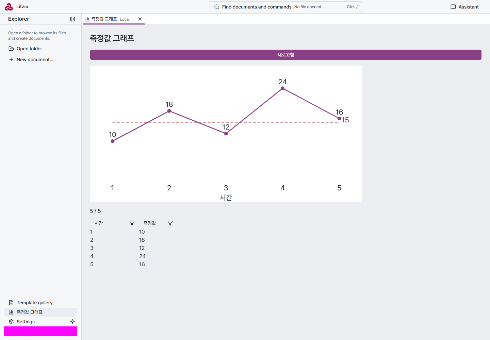 | 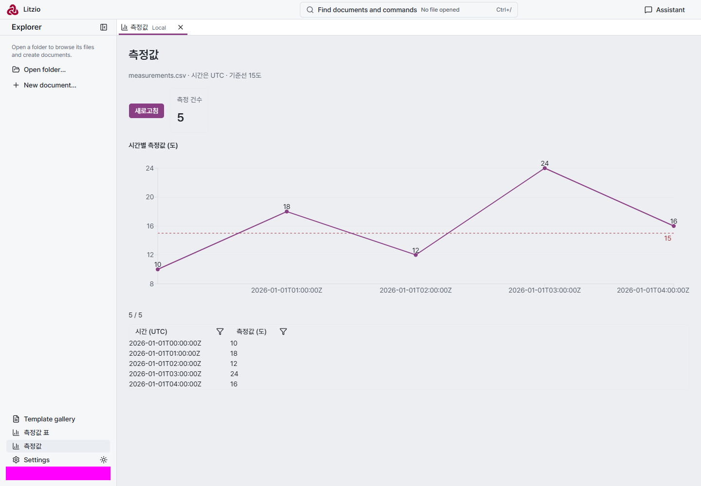 | 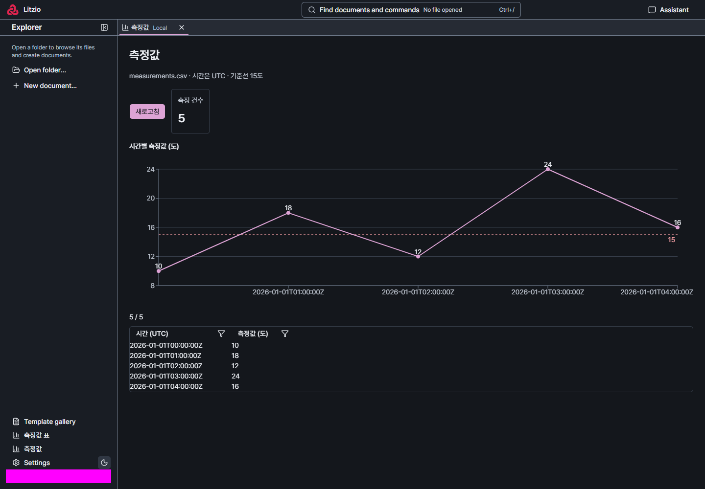 |
| 구간·hover | 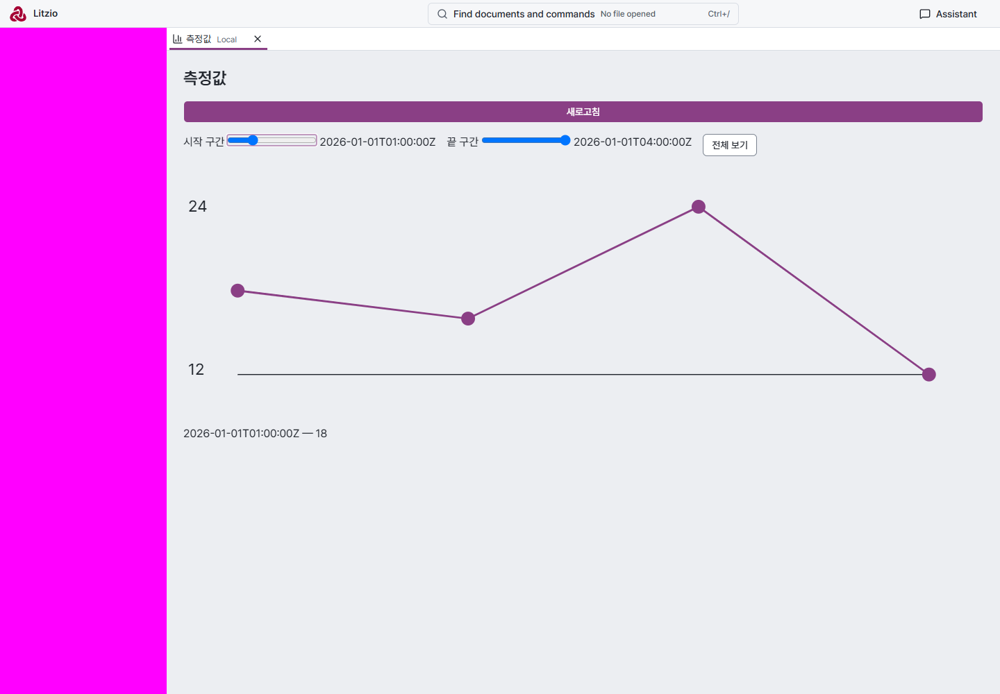 | 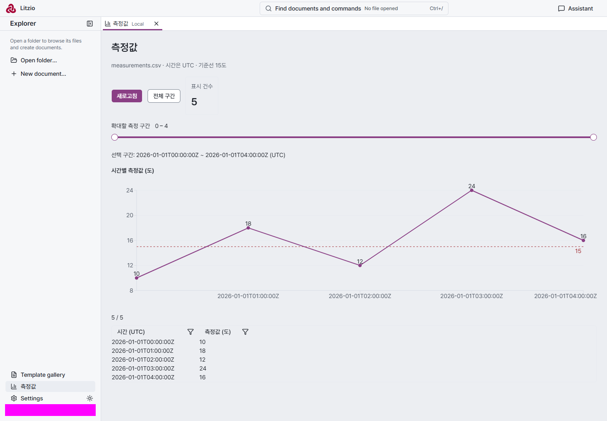 | 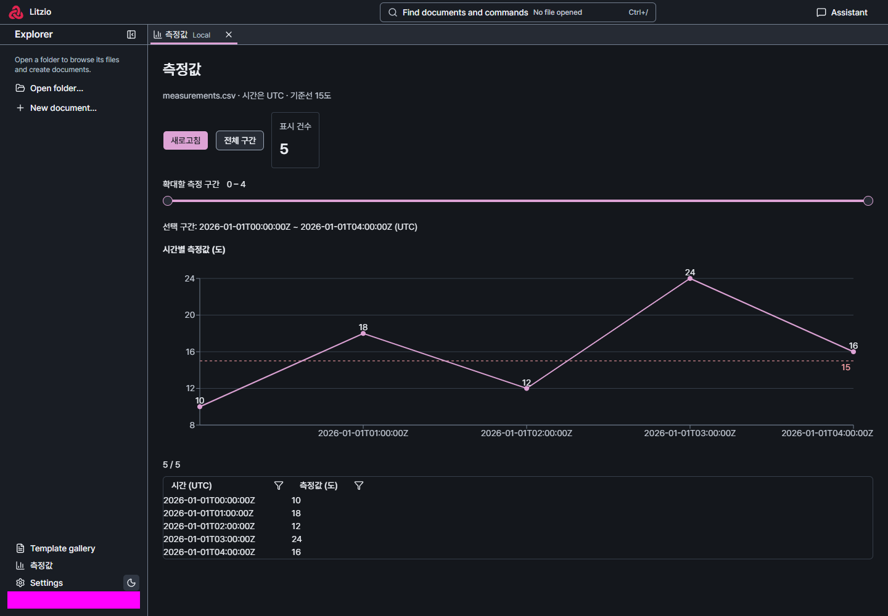 |
| 필터·합계 표 | 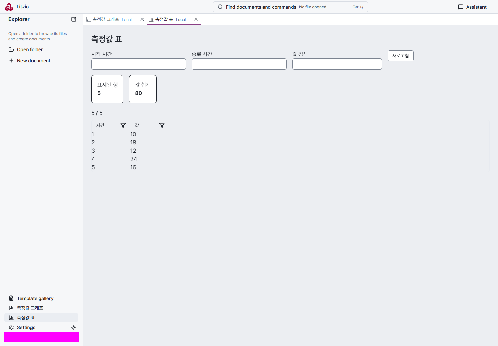 | 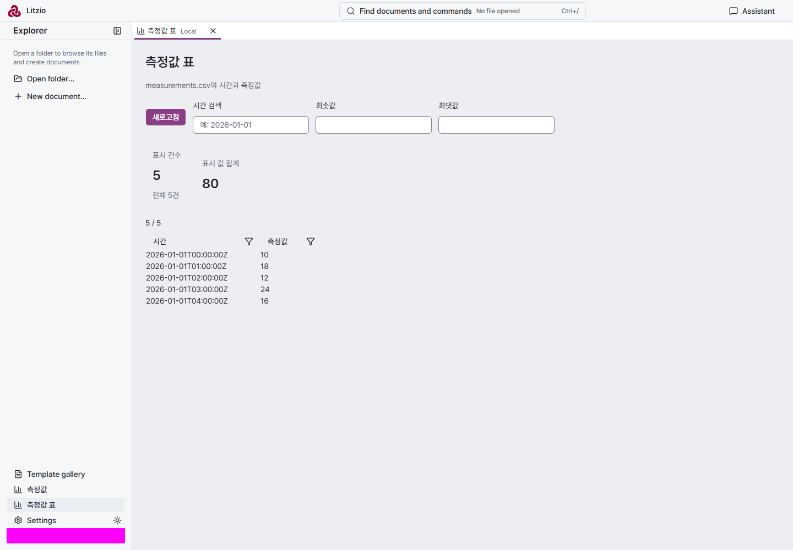 | 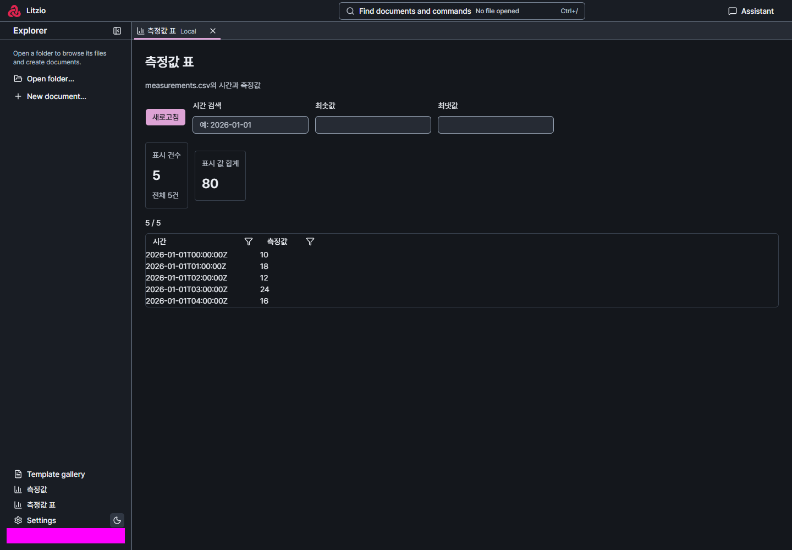 |

6장 각각 시작선·간격·잘림/겹침·위계·대비·버튼 폭을 직접 확인했다. 제목·본문·도구 줄 시작선이 맞고 버튼은 내용 폭이다. 그래프 흰 배경 상자는 없어졌으며 축·값·기준선이 양 테마 토큰을 따른다. 슬라이더는 Base UI의 토큰 외형이다. 새 합계 카드는 subtle border다. 개인 경로·계정 영역은 촬영 시 mask했다.

남은 한계도 보존한다. 표 컨테이너는 전체 폭이지만 기존 DataTable의 두 열은 여전히 왼쪽에 모인다. 표 화면의 설명 길이가 다른 두 요약 카드는 높이가 다르고 중앙 정렬된다. 긴 UTC 축 문자열은 간격에 따라 일부 tick이 생략된다. 라이트의 subtle 경계는 매우 약하다. 빈 그래프와 오류·disabled는 갤러리에서, 실제 표의 범위 오류는 조작으로 확인했다. 실제 CSV 읽기 실패와 모든 값 조합을 시험했다는 뜻은 아니다. 소유자의 시각 승인은 별도다.

### 정한 것과 이유

직접 SVG와 Recharts 3.10.1을 비교했다. 동일 esbuild minify/ESM·React external 조건으로 사용하는 Recharts exports는 **396,114 bytes / gzip 115,576 bytes**였다. 최소 정적 polyline 비교는 158/144 bytes로 훨씬 작지만 축·반응형·hover·키보드 값 탐색이 전혀 없는 하한이며 동등 기능 비교가 아니다. 직접 구현은 이 상호작용·접근성·음수/기준선 범위 처리를 계속 소유해야 하므로 라이브러리를 택했다. [Recharts 접근성](https://github.com/recharts/recharts/wiki/Recharts-and-accessibility)의 application/화살표 탐색을 사용하고 Base UI는 이미 설치된 [Slider](https://base-ui.com/react/components/slider)를 재사용한다. 수치/구간 상태는 React 화면 수명만 따르며 새 Host 상태·확장 지점·디자인 강제는 없다. 특수 차트·자체 SVG는 계속 허용한다.

### 검증과 실패 기록

- Editor·SDK 타입 검사, 토큰 검사, docs 검사 통과. 기존 Host 테스트의 authoring/screen/install 5개 통과. 공용 props는 SDK 타입, client 이름 집합은 SCREEN_UI 키로 검사한다.
- persistent profile의 production plugin-screen-code + HTTP 복구(2개), UI gallery(구간 키보드·line/bar·마우스/키보드 tooltip·empty) 통과. 갤러리는 Vite ResizeObserver 알림이 있었으나 runner 판정은 통과했다.
- 첫 단위 테스트 호출은 저장소 루트에서 실행해 상대 cwd를 기대하는 기존 Docling/Jira 2개가 실패했다(55/57 통과). 올바른 Editor cwd에서 변경 영역 5개를 다시 통과했다. 무관한 전체 suite 성공으로 보고하지 않는다.
- 브라우저 HTTP와 Vite를 한 호출로 지정한 첫 시도는 runner가 거부했다. 수동 촬영 harness 첫 두 시도는 VM에 URL 전역이 없음, catalog에 GET을 사용해 405 빈 응답을 JSON으로 읽은 문제로 실패했다. 실제 POST catalog 계약으로 고친 뒤 촬영·조작이 통과했다. 촬영 전용 순회는 CI에 추가하지 않았다.
- 실제 외부 서비스·원격 PC·패키지된 Desktop·640px 실제 생성 화면·스크린리더 청취·많은 점/긴 문자열은 미확인이다. 문서 저장은 병행 2-4 범위이며 이 변경은 invoke 수명·취소·출력 계약을 바꾸지 않는다. 직접 시작한 격리 Host·browser runner는 종료했고 임시 시험 자료는 보존했다.

## 2-4 — 화면에서 새 문서 저장

2026-11-13, Codex `gpt-6.1-terra` high, 합성 CSV(time/value, 10·18·12·24·16), 격리된 HTTP Host와 persistent Chrome에서 확인했다. 방법·API·도구를 알려 주지 않은 과제만 전달했고 계정·공급자는 바꾸지 않았다. 실제 외부 서비스·원격 PC·패키지된 Desktop 수락은 아니다. 비서의 설치·조회 보고와 아래 직접 클릭·문서 검증을 구분한다.

| 턴 | 과제 | 초 | 결과 |
| --- | --- | ---: | --- |
| 새 대화 1 | CSV를 표로 보여 주고 기준 15 초과 행을 리치오 문서로 저장하는 버튼 제작 | 64.315 | 첫 턴 성공. 3파일 42줄(host.mjs 27, 신분증 1, screen.jsx 12), 설치·조회 성공. 직접 화면에서 버튼을 눌러 18·24·16만 저장하고 새 문서 탭에서 확인, `litzio check` valid/writable 통과. 비서 자신은 화면 미확인을 명시했다. |
| 같은 대화 2 | 저장 제목 변경, 전체/초과 행 수와 평균 요약 문단 추가, 기본 파일명 변경 | 39.344 | 성공. 3파일 41줄(host 27, 신분증 1, 화면 13). 직접 저장한 문서의 제목·전체 5행·초과 3행·평균 19.33과 표를 확인하고 `litzio check` valid/writable 통과. |

총 2턴이다. 빈 줄을 포함하고 마지막 개행은 추가 행으로 세지 않았다. 1440px 라이트 [버튼이 있는 화면](../design/assets/plugin-screen-save-1592/screen-light.png)과 [저장한 문서](../design/assets/plugin-screen-save-1592/document-light.png)를 직접 검토했다. 계정 표시·폴더 위치·명령 검색의 경로 표시는 촬영 시 mask했다. 화면은 기존 Button/Input/DataTable/Notice를 사용하며 새 화면 부품이나 디자인 예외를 만들지 않았다. 시각 확인은 소유자의 승인과 별개다.

시험 구성 오류도 있었다. 첫 실제 클릭은 runner의 scratch 파일 쓰기 보호가 OS 임시 폴더를 거부했다. artifact를 수정하거나 보호를 완화하지 않고, 별도 Host의 허용 Root에 checkout scratch 출력 폴더를 추가해 재시작하고 그 폴더를 UI에서 열어 저장했다. 대화는 같은 ID를 resume했다. 재시작 뒤 resume 전 전송 1회는 Host가 거부하여 비서 턴으로 접수되지 않았다. 두 번째 저장의 제목을 본문 editor와 heading에서 찾던 촬영 스크립트도 실패했다. 제목은 기존 별도 Title textbox이므로 그 값을 검사하도록 고쳤다. 이 과정에서 만들어진 문서는 보존했으며 최종 클릭 검사와 캡처를 다시 통과했다. 이 오류들을 비서의 제작 실패나 제품 저장 실패로 계산하지 않는다.

정한 것과 이유: `saveDocument({name,authoring,folder?,open?})` 한 개를 제공했다. 기존 작업 패널처럼 대상 Host의 첫 열린 폴더를 기본값으로 삼고, 필요하면 같은 Host의 열린 폴더를 지정한다. 위치 receipt와 `open:true`의 기존 문서 탭 열기로 결과를 찾는다. 기존 CLI `create --input`과 플러그인 native-document/generated-document의 `createAuthoredDocumentFile → Core authorDocument → createDocumentSourceFile`을 재사용한다. 같은 이름은 오류이며 덮어쓰거나 자동으로 이름을 바꾸지 않는다. 원격 호출 실패는 로컬로 재실행하지 않는다.

검증: 전체 typecheck·문서·경계 검사, Host/client 38검사, 플러그인 authoring/K1·화면 관련 15검사, 기존 CLI create --input 검사, production HTTP plugin-screen-code 및 crash/reconnect Save/Reload 회귀, Vite text-mode 회귀를 통과했다. 화면 회귀에는 실제 저장·열기·이름 충돌 오류와 기존 미저장 탭 생존을 추가했다. 첫 회귀 실행은 예상된 충돌 HTTP 400을 console-error 목록에 등록하지 않아 실패했고 해당 경로·상태의 최소 발생을 명시한 뒤 재실행했다. 열린 폴더 없음과 다른 Host 폴더 거부·실패 시 재시도 없음은 client 검사, 문서 유효성과 receipt·충돌 원본 보존은 Host 검사로 보호한다. 실제 원격 PC와 대용량·긴 작업·외부 서비스는 미확인이다. 필수 PR CI 결과는 PR의 최종 head를 따른다. 직접 시작한 Host·browser·시험 프로세스는 종료했고 시험 자료 폴더는 재귀 삭제하지 않았다. 비공개 로컬 시험 위치는 최종 인계에만 남긴다.

### 2-4 독립 리뷰 후 공용 생성 실패 보완

리뷰 head `4649391e`에서 `createAuthoredDocumentFile` 호출 직전 숫자 fd의 첫 8바이트를 실제로 쓰고 ENOSPC를 던지도록 fs.writeFileSync와 syncBuiltinESMExports를 사용했다. 기존 Editor 생성 검사 파일에 넣은 회귀가 최종 문서 잔존 단언에서 실패해 리뷰 결함을 재현했다. 원인은 최종 이름을 wx로 연 다음 직접 쓰고 close만 하던 `createDocumentSourceFile`이다. 같은 함수의 CLI 생성, 템플릿으로 새 문서 생성, 비서 및 기존 플러그인 결과→문서 흐름에도 있던 결함이다.

공용 함수 한 곳을 기존 `file-commit.createFile`로 전환했다. 임시 형제 파일에 쓰기·fsync를 완료한 뒤 hard link로 배타 게시하며 EEXIST 분류와 path/source/revision/identity receipt를 유지한다. 덮어쓸 수 있는 rename이나 직접 쓰기로 fallback하지 않는다. 새 상태·계층·화면 전용 경로는 없다. 회귀는 수정 후 부분 쓰기 실패에 최종/임시 파일이 없고, 같은 이름 재시도가 native 문서·일치하는 revision/identity를 반환하며 기존 파일 충돌은 원본을 보존함을 확인했다. flush·게시 실패와 게시 시점 경쟁은 기존 file-commit 검사가 담당하며 Host마다 중복하지 않았다.

별도 사용자 템플릿 저장(`saveTemplate`)은 다른 함수에서 직접 wx로 쓰므로 이번 공용 생성 수정에는 포함되지 않는다. 그 별도 경로의 실패 게시 보완은 후속으로 제안하며 이번에 해결했다고 주장하지 않는다. 실제 원격 PC·외부 서비스·대용량·패키지된 Desktop 등 비차단 검증 확대는 요청 범위 밖이라 반영하지 않았다.

### 2-3·2-4 병합 후 통합 확인

#1601 병합 후 master를 merge해 공용 부품은 screenUI 한 객체로, saveDocument는 별도 화면 prop으로 유지했다. 제작 스킬의 SCREEN_UI_GUIDANCE·부품 목록·배치 예시와 저장 API를 함께 보존했고 기본 screen/chart 골격은 ScreenLayout 안 Toolbar의 내용 폭 불러오기·저장 버튼, 합계, 전체 폭 Chart·표를 사용한다. 위 2-3·2-4의 측정 기록은 모두 유지했다.

통합 골격을 격리 HTTP Host에서 scaffold·install하고 persistent browser로 직접 불러오기→저장→문서 탭 열기를 확인했다. 그래프·합계 64·표, Toolbar 안 내용 폭 저장 버튼과 저장 문서의 10·18·12·24 및 제목을 검사하고 litzio check valid/writable을 통과했다. 실제 비서를 다시 호출하지는 않았다. 전체 typecheck, 관련 Host·제작·저장 15검사, production plugin-screen-code와 HTTP crash/reconnect 2검사(44.2초), UI gallery 1검사(21.3초), 통합 골격 수동 확인 1검사(6.2초), CLI/Editor build·docs 검사를 통과했다. 갤러리의 Vite ResizeObserver 알림은 기존처럼 있었으나 runner 판정은 통과했다. 직접 시작한 Host·browser는 종료했고 자료 폴더는 보존했다. 필수 CI는 병합 커밋 head에서 확인한다.

## Screen-parts polish and template publication follow-up

The follow-up uses synthetic gallery and screen-code fixtures, without assistant calls.
Layout Rules' wrapping/overflow boundary and P09/P10's shared table/tools remain intact;
neither document mandates equal-width columns. Keep DataTable's measured content columns,
limit only code-screen scroll borders to content width, and preserve declarative consumers.
Toolbar cards stretch per flex row with top-aligned label/value; buttons stay centered.
Recharts preserves endpoint ticks; its Text wraps long strings within 140px and endpoint
anchors face inward. Intermediate ticks may be omitted. Long UTC/60-point coverage is new.

| Capture | Before | After |
| --- | --- | --- |
| Gallery 1440 light | [PNG](../design/assets/screen-parts-polish/before-parts-1440-light.png) | [PNG](../design/assets/screen-parts-polish/parts-1440-light.png) |
| Gallery 1440 dark | [PNG](../design/assets/screen-parts-polish/before-parts-1440-dark.png) | [PNG](../design/assets/screen-parts-polish/parts-1440-dark.png) |
| Screen 1440 light | [PNG](../design/assets/screen-parts-polish/before-screen-light.png) | [PNG](../design/assets/screen-parts-polish/screen-light.png) |
| Screen 1440 dark | [PNG](../design/assets/screen-parts-polish/before-screen-dark.png) | [PNG](../design/assets/screen-parts-polish/screen-dark.png) |
| Long labels 640 dark | Added stress fixture | [PNG](../design/assets/screen-parts-polish/parts-long-640-dark.png) |
| Table 640 light | Original gallery above | [PNG](../design/assets/screen-parts-polish/parts-table-640-light.png) |

Windows persistent Chrome, DPR 1, 1440/640 x 1000, gallery and production HTTP screen scenario.
Original gallery overview precedes the added long-label fixture; after captures include that
fixture and separate table view. Account/folder areas are masked in application captures.
Review checks label/value axes, spacing, clipping/overlap, typography hierarchy and contrast.
The subtle light border remains deliberately quiet. Owner visual approval is separate.

UI verification: Editor/SDK types, token checks, UI gallery, production screen-code and HTTP crash/reconnect passed. No actual assistant or packaged Desktop was invoked. Long-label 1440px review caught an additional overlap; increased library tick spacing and checked both supported widths. Persistent runner processes were closed by fixture teardown.
Template fault injection wrote 8 bytes then threw ENOSPC: before, Retry.md remained and the
regression failed; after createFile reuse, no final/temp sibling remains, same-name retry
succeeds and a subsequent collision preserves the complete template. Existing Host template
routes retain case/reserved-name/source-scope checks. No replacement semantics were added.

Direct-write inventory (server and CLI sources):
- document-templates: final native template write fixed here using createFile.
- assistant-attachments: clipboard image bytes are written directly to a private conversation
  attachment file, before indexing. This is a remaining image-related path, reported only:
  createFile takes UTF-8 text and createFileFromPath requires staging, so this is more than a
  one-line switch. A write fault can leave an unindexed partial attachment.
- asset-api: image bytes go to an owned temporary sibling, fsync, exclusive hard-link publish;
  generated-documents/jobs/review-workspaces and authoring-templates write staging candidates,
  subsequently admitted/published through shared paths. No direct final document write found.
- sample-documents: copies into a private staged directory then renames the complete set.
- Non-document writes, unchanged: assistant attachment/conversation indexes and settings;
  daemon identity/log/locks; remote-host registry/locks/cache; reset markers; provider-generated
  instructions/skills and CLI shims; plugin artifact scaffold/screen bundle/skills, installation
  registry and secret-store files. CLI cli.ts/document-api import writeFileSync but do not call it;
  CLI daemon writes temporary registry state. No additional final native-document writer found.

Verification: Editor/SDK types, template Host + partial-write tests, image-assets + token tests,
UI gallery, production screen-code + crash/reconnect, production build and docs checks.
Initial gallery selector and element screenshot attempts were corrected after inspection;
element capture clipped the long-label right edge, so viewport captures are used instead.
No actual assistant, installed application, user daemon/data, remote PC, packaged Desktop,
power-loss or all possible string/value combinations were tested. Runner-owned processes
are torn down by the existing persistent fixture; test artifacts are retained.

## 3단계: 협의 절차와 제작 시험

### 방법과 사전 대본

2026-11-13, 격리된 production HTTP Host, 기존 Codex 로그인, `gpt-6.1-terra` high / full-access, 합성 자료만 사용했다. 설치된 앱·사용자 daemon·데이터를 사용하지 않았으며 시험 자료는 보존했다. 질문 답변은 공용 질문 API로 전달하고, 화면 검토는 별도 persistent Chrome `pnpm browser:test`로 수행했다. 비서에게 방법·부품 이름을 알려 주지 않았다. 첫 과제의 세 팀 Markdown은 이번 주·다음 주·위험의 같은 구조다. 변환 계약 네 파일과 13쪽 합성 PDF는 시험 폴더로 복사했다. 실제 서버는 지정된 기존 docling-serve 1.38.2 컨테이너만 시작했다. ready 첫 조회는 시작 직후 연결 종료로 실패했고 이후 200을 확인했다.

과제 문장과 답변 대본은 실행 전에 고정했다.

1. “매주 팀별 주간 보고를 모아서 한 장으로 정리하는 걸 만들어 줘.” 답: 같은 팀 파일을 매주 갱신, 버튼 실행, 현재 폴더의 세 팀 이번 주·다음 주·위험을 표로 모아 한 장 분량의 화면과 같은 폴더의 새 리치오 문서로 저장. 반복 사용하며 세 팀 내용이 빠짐없으면 완료. 규칙 취합 도구 하나로 시작한다.
2. “PDF를 Docling 서버로 변환해서 결과를 저장하는 플러그인을 만들어 줘.” 답: 로컬 5001 서버·인증 없음, PDF 한 개, 현재 폴더에 JSON·원본 참조·변환 기록, 권장값 기본·옵션 조정·반복 사용. 상세 계약은 아직 없음. 기존 플러그인 수정을 물으면 별도 생성(과제 3 원본 보존).
3. 계약 네 파일을 명시하고 로컬 5001 서버·인증 없음·설정으로 주소 변경·권장 프로필·고정/조정 옵션 구분·document.json/기록/원본 참조·실제 옵션 기록·반복 사용 화면 하나·sample.pdf의 실제 변환과 완전 성공 확인을 한 메시지에 요청했다. 서버 주소·입출력·옵션을 이미 줬으므로 추가 협의 답변은 없다.

### 관측과 판정

과제 1 첫 턴 44.357초: 세 보고를 먼저 읽은 뒤 파일 갱신 방식, 화면+문서 여부, 버튼/요일 자동 실행을 세 단일 선택 질문으로 물었다. 자료에서 알 수 있는 팀·항목·경로를 새로 묻지 않았다. 갱신 주기는 디스크에서 알 수 없는 조건이다. 리치오 계획 문서를 먼저 생성했다. 답변 턴 48.874초: 계획을 다시 읽고 규칙 기반 취합 도구를 설치했다. 이미 같은 구조의 문서여서 AI 요약 없이 세 항목을 그대로 모으며, 사용자가 규칙 취합을 선택한 것과 일치한다. 비서는 직접 조회로 세 행을 확인했고 화면·저장 버튼은 미확인이라고 밝혔다. 시험자가 1440px 화면의 세 팀/모든 열과 자료 값을 직접 확인했다. 이 시험의 저장 버튼 실제 저장·문서 재열기는 미확인이다. 현재 세 팀과 경로를 코드에 고정해 다른 팀/폴더로 재사용하는 도구는 아니다. 사용자 계획 수정 후 반영도 시험하지 않았다.

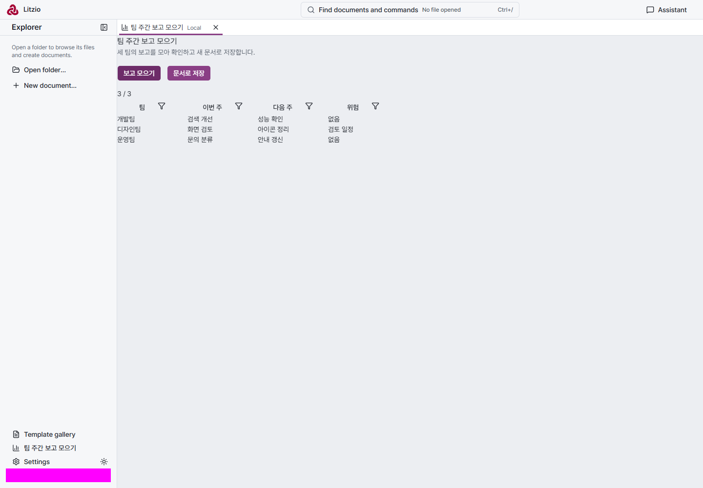

과제 2 첫 시도는 172.149초 동안 사용자 메시지 외 응답 이벤트가 없어 시험자가 중단했다. 과제 3과 실행 시간이 겹쳤으나 원인은 확정하지 않았다. 새 대화 재시험을 숨기지 않으며 초기 실패를 성공 집계에서 제외하지 않는다. 재시험에서는 서버 주소·인증, 입력/저장 방식, 이미 설치된 변환 도구 수정/별도 생성을 질문 카드로 물었다. 서버 주소를 사전에 가정하지 않고 선택지에 예시로 제시했다. 기존 도구 질문은 같은 격리 Host에 남은 과제 3 산출물이 원인이므로 완전히 빈 설치 환경의 시험은 아니다. 옵션 질문은 별도로 하지 않았고 시험자가 자유 입력 답에 옵션 조건을 함께 제공했다.

과제 3 첫 턴 69.518초: 조건을 되묻지 않았으나 골격만 만들고 중단했다. Python requests 없음은 환경 실패였고 Node 대체 구현을 완성하지 않은 채 끝났다. “묻지 않고 한 번에 제작”은 **실패**다. 후속 156.228초에는 설치·설정·조정 옵션 화면·저장 코드를 만들고 defaults 읽기 작업을 공개했지만 실제 변환은 수행하지 않았다. 비서는 화면 전용 쓰기 handler를 공식 읽기 도구로 부를 수 없다고 설명했으며, 이는 공개 쓰기 operation을 선언해 CLI로 호출하는 대안을 활용하지 못한 제작 문제다. 화면 연결 시도는 CUA inventory 조회 뒤 접근 불가로 종료했고 다른 앱을 조작한 기록은 없다. 시험자는 별도로 기존 앱·daemon 금지 범위를 한 번 상기시켰다(steer 메시지).

시험자가 화면의 PDF 경로·결과 경로·쪽 수를 입력하고 변환을 클릭하자 `Operation timed out. Check the service connection. Check the target before retrying a write.` 뒤 `Unavailable`로 바뀌었다. 한 handler가 업로드·poll·결과 저장을 끝까지 기다린 설계였다. 서버 작업 접수 ID와 후보 기록은 남았고, 비서는 후속에서 해당 ID의 success를 조회했다. 시간 제한을 늘리거나 새 K1 엔진을 만들지 않았다. 비서에게 재전송하지 말고 기존 상태부터 확인하도록 오류를 전달해 수정 시험을 이어 갔다.

### 상태 조회 조사 (#1360)

현재 구현을 기준으로 한다. #1501·#1514의 역사와 현재 소스를 구분했다. 상태는 이미 상당 부분 JSON이며 픽셀을 봐야만 하는 것은 아니다.

| 경로 | 얻는 상태 / 출력 | 비서·플러그인 접근 / 한 번에 얻는 범위 |
| --- | --- | --- |
| `daemon status --json` / daemon health | state/running, 버전·프로토콜·PID·URL·허용 roots, 수동 instance 목록 | CLI는 수명 상태를 한 번에 조회. roots는 열린 폴더가 아님. 탭·활성 문서 없음 |
| 대화 입력 folders/document | 열린 폴더·활성 저장 문서 경로 | 비서는 발화 맥락으로 받음. 실시간 전체 상태나 미저장 본문이 아님 |
| `read_screen_context` → `ScreenInfo` | activeTab, tabs(id/kind/hostId/title/path?/unsaved), folders | 한 번에 JSON. 발화 창이 응답하며 Host는 in-flight 요청만 소유. 창 없는 CLI/처리 코드에는 없음. 픽셀·본문·플러그인 입력/결과 없음 |
| `plugins list` / manage_plugins list | installed/trusted/enabled/running/settings/status/error/digest | CLI와 비서가 한 번에 목록 확인. `status()`는 strict {available,message}로 작업 진행률·결과는 없음 |
| 공개 operation invoke | 선언 schema의 JSON + receipt | CLI와 비서 읽기 호출. 화면 invoke도 같은 공개 계약 사용 가능. 각 플러그인이 progress/result 읽기 작업을 선언할 수 있음 |
| 플러그인 처리 코드 PluginContext | settings/secrets/platform/env/isDirectory | 자기 불변 설정과 일반 Node 파일·네트워크. 열린 폴더·활성 문서를 주는 Host callback 없음 |
| 화면 props React/ui/invoke/saveDocument | 자기 작업 호출, 새 문서 저장 | 현재 폴더 목록·활성 문서·자기 설정 props 없음. saveDocument는 내부 roots를 사용하나 화면에 목록을 돌려주지 않음. 설정은 처리 코드의 읽기 작업으로 반환 가능 |

출력 envelope는 수명 상태, 창 메타데이터, 플러그인 목록, operation receipt로 다르며 이 전부를 묶는 조회는 없다. 서로 다른 소유권·수명을 가진 상태이므로 같은 뜻이라고 합치면 안 된다. Host roots와 열린 폴더를 혼동하면 잘못 저장한다.

실제 필요: 주간 취합은 발화 folders와 파일 읽기로 입력 위치·구조를 알고 코드에 고정했다. 변환은 자기 설정을 defaults로 전달하지만 파일과 저장 위치는 절대 경로를 입력하게 했다. native 파일 선택을 제공하지 않았으며 브라우저에서 PDF를 고르는 것과 Host 파일 경로를 얻는 것을 혼동하지 않았다. 초판은 진행 공개 작업이 없고 status는 준비됨이라 비서가 진행을 알 수 없었다. 실패 후 서버 task ID·후보 기록을 파일에서 찾아 상태를 알아냈다. 이는 공통 진행 조회의 제품 성공이 아니다.

가장 작은 제안:

- 처리 진행은 기존 공개 읽기 operation으로 `{id,state,message,result?}`를 반환하는 관례를 제작 지침에 안내한다. 새 Host job store·타임아웃 변경 없이 접수 handler가 즉시 반환하고 화면/비서/CLI가 같은 operation을 조회한다. 중단은 plugin 소유이며 로컬 중단과 서버 중단을 구분한다. 현재 strict status()에 임의 작업 schema를 덧붙이지 않는다. 이번 PR은 이 안내와 낡은 K1 안내 제거만 구현한다.
- 열린 폴더·활성 문서가 실제 부족하다. 기존 ScreenInfo를 재사용해 명시한 window/session에 대한 현재 folder·active document를 Host 공용 조회로 읽고 CLI·PluginContext·화면이 같은 정의를 소비하는 것이 최소 후보다. 그러나 현재 Host는 창 상태를 저장하지 않으므로 창 등록/갱신/종료·신선도·창 없는 상태·복수 창 선택을 먼저 정해야 한다. 임의 “첫 창”·stale 캐시를 이번 PR에 넣으면 소유권을 바꾸므로 **제안만** 남긴다. 전체 상태 schema나 새 파일 선택 UI를 만들지 않는다. 병행 Host UI 삭제의 선택기 코드도 변경하지 않았다.

### 비교 결론과 검증 경계

- 협의는 주간 취합에서 입력을 먼저 확인하고 세 선택지로 범위를 좁혔다. 1·2단계의 바로 만들기와 달리 계획/입출력을 합의하는 이점은 관측됐다. 비개발자 실제 사용자의 시행착오가 줄었다는 일반화는 합성 대본 한 건으로 증명하지 못한다.
- 조건을 충분히 준 변환은 되묻지는 않았으나 한 번에 완성하지 못했다. 협의 지침만으로 실행 설계·계약 검증 문제가 해결되지 않는다.
- 카드와 계획 문서의 충분성은 아직 미확정이다. API 답변으로 진행했으므로 실제 사용자의 카드 읽기/선택 부담, 계획을 찾아 고치는 흐름, 여러 라운드에서 결정을 유지하는 품질은 미검증이다. 전용 제작 화면 재도입의 근거로 성공을 과장하지 않는다.

Editor·전체 패키지 typecheck, CLI/Editor production build, 기존 제작·설치·화면 관련 Host 검사 9개, docs 검사 통과. 지침 문구를 고정하는 새 테스트는 추가하지 않았다. 첫 촬영은 사용자 지정 scenario에 --screenshots가 허용되지 않아 runner가 거부했고, 수동 scratch harness에서 직접 캡처했다. 변환 오류 촬영 검사는 `timeout`과 실제 `timed out`을 혼동해 실패했으며 trace에는 실제 timeout→Unavailable이 남았다. 개인 경로가 남은 캡처는 공개하지 않는다. 화면을 고치거나 생성 코드를 손으로 고치지 않았다. 대형/실문서·다른 OS·원격 서비스·Copilot·사용자 계획 편집·설치형 Desktop은 미확인이다.

### 후속 수정·설치 시험 결과

| 턴 | 초 | 관측 |
| --- | ---: | --- |
| 주간 요청 / 카드 답 | 44.357 / 48.874 | 자료 먼저 확인·3질문·계획·3팀 조회·화면 확인 |
| 변환 조건 부족 첫 시도 | 172.149 | 무응답 중단, 원인 미확정 |
| 조건 부족 새 대화 / 답변 | 67.341 / 164.054 | 질문 뒤 계획 생성, 3파일 42줄 설치. PDF 없는 폴더여서 변환은 미확인 |
| 계약 전체 첫 턴 / 계속 | 69.518 / 156.228 | 무질문이나 골격 중단, 후속 설치도 변환 미실행 |
| 실제 timeout 전달 뒤 수정 | 148.923 | 기존 task success 확인, 재제출 없이 접수+job/recover 조회로 수정·재설치 |
| 폴더 설치 첫 요청 / 등록 해제 후 | 44.844 / 23.516 | 이미 설치됨 확인 뒤 기존 Host 사본을 재설치. 독립 폴더 설치 증거는 아님 |

과제 2 최종은 3파일 42줄(host 24, manifest 1, screen 17), 과제 1은 3파일 28줄(host 21, manifest 1, screen 6)이다. 과제 3은 5파일 579줄(host 61, manifest 56, screen 13, options 398, profile 51)이며 옵션/프로필 자료가 대부분이다. 줄 수는 빈 줄 포함·마지막 개행 제외. 두 계획 문서는 CLI check valid/writable을 통과했다. 과제 3은 조건이 충분한 화면 하나여서 계획 문서를 강요하지 않았다.

시험자가 수정본 화면에서 **새 결과 위치로 명시적으로 별도 시험**을 실행해 접수→2초 간격 job 조회→finished를 확인했다(persistent browser 49.6초). 서버 처리와 파일 저장은 46.254초였다. 결과는 후보 폴더의 source.pdf/document.json/conversion-record.json이며 서버 task/result success·errors 0·13쪽·DoclingDocument 1.10.0·15개 data URI와 실제 옵션 기록을 확인했다. 그러나 이미지 실제 decode 검증은 구현하지 않고 `image_decode_verified:false`, `complete:false`, `state:incomplete`로 남겼다. 따라서 **완전 성공 아님**이다. 기본 프로필 request와 actual_request는 전체 일치했고 overrides는 {}였다. 원본을 중복 복사하지 않는 fixtures의 참조 예외도 구현하지 않아 source.pdf를 복사했다. 중단 UI와 공개 취소 handler도 없다. 이런 계약 미완성을 플랫폼 기능 부족으로 포장하지 않는다.

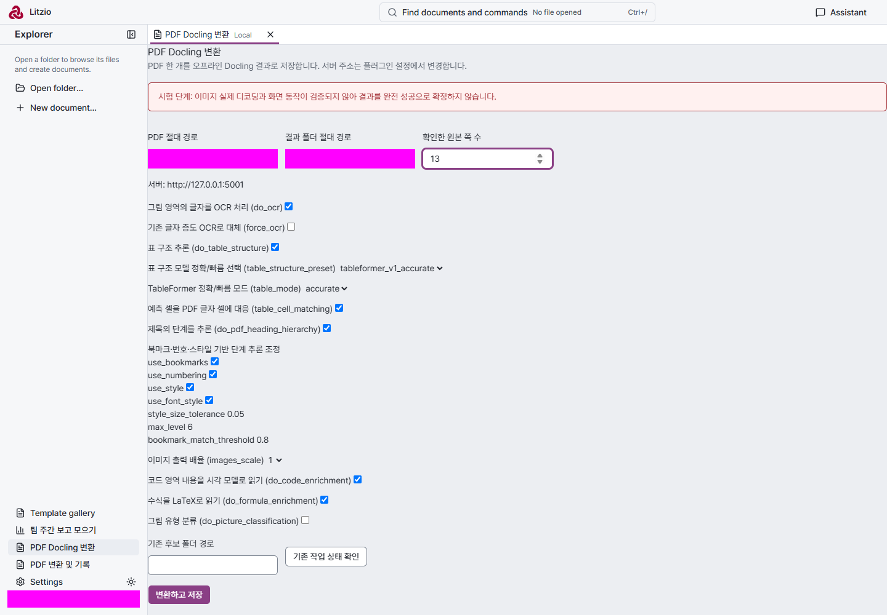

실제 장기 처리의 접수+상태 조회는 기존 플랫폼으로 됐다. 문제는 비서의 초기 설계와 미완성 검증이었다. job은 화면 전용이며 공개된 읽기는 defaults/recover뿐이다. 비서는 recover로 기존 서버 task 상태를 알 수 있지만 실행 중인 로컬 job을 공용 CLI로 조회하지는 못한다. status() 자체도 여전히 준비됨이다. 첫 호출 timeout 이후 자동 재제출하지 않고 기존 task 상태를 조회한 것은 확인했다. 패키지 설치·Node 파일 I/O·JSON 저장도 가능했다. 파일 고르기는 과제 2에서는 폴더의 PDF 목록 select, 과제 3에서는 절대 경로 입력으로 구현해 비개발자 사용성이 부족하다. 새 native picker가 필수라는 결론은 내리지 않는다.

공통 상태 API는 구현하지 않았다. 창 소유 상태를 Host 공용 상태로 옮기는 것은 값 몇 개를 props에 붙이는 변경이 아니며, window/session 수명과 CLI의 대상 선택을 정하지 않고 구현하면 현재 계약과 충돌한다. 이번 시험에서 필요한 folder/active-document만 기존 ScreenInfo 정의로 제공하는 후속을 제안하고, 전역 큰 schema·원격 Host 선택기 변경은 하지 않는다.

과제 2의 실제 화면 확인은 **실패**했다. inspect의 공개 inputSchema가 additionalProperties:false인 빈 객체인데 화면은 `{folder:""}`를 보내 HTTP 400 `Invalid operation input`을 받았다. 설치와 비서 읽기 도구의 success만으로 실제 화면을 성공 처리하면 놓치는 결함이다. 시험자는 생성 코드를 고치지 않았다. 후속 촬영에서도 같은 오류와 HTTP 400을 보존했다.

폴더에서 독립 설치는 기존 등록과 제작 사본을 보존 위치로 옮긴 뒤 다시 요청해 확인했다(29.545초). 비서는 downloaded-plugin의 5파일을 Host 제작 폴더에 복사해 install ID로 설치하고 원본/설치 사본 hash 일치와 defaults 호출을 확인했다. 원본은 수정하지 않았다. 공개 관리 schema는 install directory도 지원하지만 비서는 복사+ID 경로를 골랐다. 따라서 이번 시험에서 “폴더에서 설치” 플랫폼 능력 부족은 재현되지 않았다. 처음 두 시도는 이미 있는 사본을 확인/재설치한 것이어서 독립 설치 증거와 구분했다.

전체 전송은 12회(원인 미확정 무응답 시도, 카드 답변, 경계 상기 steer, 설치 확인/재시험 포함)로 20턴 안이다. 계정·공급자·모델은 유지했다. 시험자가 손으로 바꾼 플러그인 코드는 없다. 초판·수정 최종본·받아 둔 폴더·설치 사본과 실제 결과 후보를 각각 보존했다. 최종본은 완전 성공 검증·취소·fixtures 원본 참조·공개 live job 조회가 미완성이다. 해당 부족을 플랫폼 변경으로 대신하지 않았다. 화면 품질은 과제 1의 표는 읽히지만 기본 화면 좌측 배치이고, 과제 3의 영문 옵션명과 절대 경로 입력은 비개발자가 쓰기 어렵다. 시각 승인은 소유자 별도다.

과제 2 [실제 오류 화면](../design/assets/plugin-screen-code-1592/stage3/missing.png), 과제 3 [후속 화면](../design/assets/plugin-screen-code-1592/stage3/converter-final.png)도 1440px로 검토했다. 경로/계정 영역을 촬영 시 가렸으며 원본의 배치·내용은 고치지 않았다. 초기 경로 mask selector가 type 없는 input을 놓친 촬영은 폐기하고 label 기반 mask로 다시 촬영했다. 질문 카드 API는 실제 응답 전달을 검증했으나 공개용 카드 캡처는 제출하지 않았다. 새 제작 지침의 장기 처리 문장은 첫 timeout 관측 후 추가했으며 실제 AI 후속 수정은 오류 전달에 대한 자율 수정이지 새 빌드 지침을 다시 읽힌 비교 시험이 아니다.

직접 시작한 격리 Host는 소유 health/PID 확인 후 stop으로 종료했고, browser runner들은 persistent context teardown을 마쳤다. 지정된 컨테이너도 중지했다. 임시 자료는 재귀 삭제하지 않았으며 로컬 위치는 공개 기록 밖의 인계에만 남긴다.
